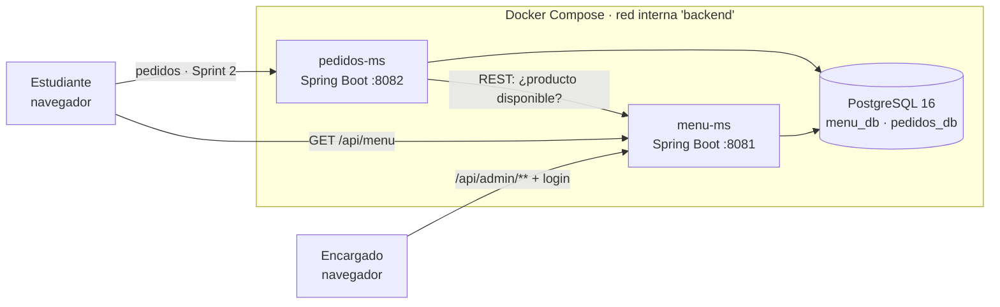

# Sistema de pedidos anticipados – Cafetería UdeC Ubaté

Proyecto de la asignatura **Sistemas Operativos** · Ingeniería de Sistemas y Computación
Universidad de Cundinamarca, seccional Ubaté · Docente: Erick Sang Ramírez

**Equipo:** Julian Esteban Ordoñez · Yenderson Julian Silva Gomez · Michell Daniela Caicedo

## Problema

En la hora del almuerzo casi todos los estudiantes salen de clase al mismo tiempo y la
cafetería se congestiona. En la encuesta aplicada (n = 14) el **93 %** ha llegado tarde a
clase por esperar en la cafetería, el **79 %** se queda sin almorzar al menos a veces y el
**86 %** solo conoce el menú y los precios cuando llega. El **79 %** usaría una aplicación
web para pedir con anticipación.

## Solución

Dos microservicios que se comunican por API REST y se ejecutan en contenedores Docker:

| Microservicio | Puerto | Responsabilidad |
|---|---|---|
| `menu-ms` | 8081 | Publicar el menú del día: productos, precios y disponibilidad. |
| `pedidos-ms` | 8082 | Recibir pedidos anticipados con hora de recogida y cupo por franja de 15 minutos. |



Cada microservicio tiene **su propia base de datos y su propio usuario** en PostgreSQL
(base de datos por servicio). La base de datos no se publica fuera de la red interna de Docker.

## Tecnologías (software libre)

| Capa | Herramienta |
|---|---|
| Sistema operativo del servidor | Ubuntu Server 24.04 LTS (máquina virtual en VirtualBox) |
| Contenedores | Docker + Docker Compose |
| Backend | Java 17, Spring Boot 3.5 (Web, Data JPA, Validation, Security, Actuator) |
| Base de datos | PostgreSQL 16 |
| Frontend | HTML, CSS y JavaScript servidos por `menu-ms` |
| Construcción y pruebas | Maven, JUnit 5, MockMvc, H2 (solo pruebas), JaCoCo |
| Control de versiones e integración continua | Git, GitHub, GitHub Actions |
| Seguridad del código | Trivy, Gitleaks, Dependabot |

## Cómo ejecutarlo

Requisitos: Docker Desktop (Windows) o Docker Engine (Linux).

```bash
cp .env.example .env          # en Windows: copy .env.example .env
# edite .env y cambie TODAS las claves
docker compose up --build -d
```

- Menú del día (estudiante): http://localhost:8081/
- Panel del encargado: http://localhost:8081/admin.html (usuario y clave de `.env`)
- Estado de los servicios: `docker compose ps`

Para detener: `docker compose down` (agregue `-v` para borrar también los datos).

### Pruebas automáticas

```bash
cd menu-ms && mvn verify      # informe de cobertura en target/site/jacoco/index.html
cd ../pedidos-ms && mvn verify
```

Cada criterio de aceptación de las historias del Sprint 1 tiene su prueba
(ver `menu-ms/src/test`). GitHub Actions las ejecuta en cada `push`.

## API

| Método | Ruta | Acceso | Historia |
|---|---|---|---|
| GET | `/api/menu` | Público | CF-MENU-0002 |
| GET | `/api/menu/productos/{id}` | Público (lo usa `pedidos-ms`) | CF-PEDI-0001 |
| GET | `/api/admin/productos` | Encargado | CF-SEGU-0001 |
| POST | `/api/admin/productos` | Encargado | CF-MENU-0001 |
| PATCH | `/api/admin/productos/{id}/estado` | Encargado | CF-MENU-0003 |

Ejemplo:

```bash
curl -u encargado:SU_CLAVE -H "Content-Type: application/json" \
     -d '{"nombre":"Almuerzo corriente","categoria":"ALMUERZO","precio":11000}' \
     http://localhost:8081/api/admin/productos
```

## Avance por sprint

| Sprint | Fechas | Historias | Estado |
|---|---|---|---|
| 1 | 9 – 15 nov 2026 | CF-MENU-0001, CF-MENU-0002, CF-MENU-0003, CF-SEGU-0001 | ✅ Implementado (en revisión) |
| 2 | 16 – 22 nov | CF-PEDI-0001, CF-PEDI-0002, CF-MENU-0004 | Planificado · ya existe el cliente REST hacia `menu-ms` |
| 3 | 23 – 29 nov | CF-PEDI-0003, CF-PEDI-0009, CF-PEDI-0004, CF-SEGU-0003 | Planificado |
| 4 | 30 nov – 6 dic | CF-PEDI-0005 a 0008, CF-SEGU-0002 | Planificado |
| 5 | 7 – 13 dic | CF-MENU-0005, CF-MENU-0006 + pruebas de integración y despliegue | Planificado |

El detalle está en `docs/planificacion/` (Product Backlog con cronograma e Historias de Usuario en Excel).

## Ciberseguridad y calidad

- **Control de acceso:** solo el encargado autenticado modifica el menú; la contraseña se
  guarda cifrada con BCrypt y nunca está escrita en el código. Lo que no se permite
  explícitamente se niega por defecto.
- **Validación de entradas en el servidor** (nombre, categoría, precio) y rechazo de
  etiquetas HTML/JavaScript; el frontend inserta texto con `textContent` para evitar XSS.
- **Errores sin detalles internos:** el usuario nunca ve trazas ni mensajes de excepción.
- **Cabeceras de seguridad:** Content-Security-Policy, X-Content-Type-Options,
  X-Frame-Options y Referrer-Policy.
- **Secretos fuera del repositorio:** claves en `.env` (ignorado por Git); Gitleaks revisa
  que no se suba ninguna por error.
- **Contenedores endurecidos:** imágenes mínimas (JRE Alpine), el proceso no corre como
  root, la base de datos no se expone al exterior y cada servicio tiene un usuario de base
  de datos con acceso solo a su información.
- **Dependencias:** Trivy busca vulnerabilidades conocidas en cada `push` y Dependabot
  propone actualizaciones semanales.
- **Calidad:** pruebas automáticas por criterio de aceptación, cobertura con JaCoCo e
  integración continua con GitHub Actions.

## Flujo de trabajo con Git

- `main`: versión estable, solo recibe cambios por Pull Request con la CI en verde.
- `develop`: integración del sprint en curso.
- `feature/CF-XXXX-0000-descripcion`: una rama por historia de usuario.
- Mensajes de commit con el formato `tipo(alcance): descripción [ID de la historia]`.
